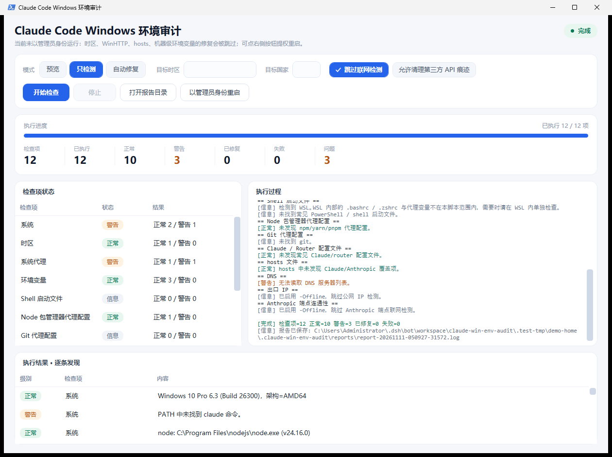

# Claude Env Audit

Claude Code 环境检测与修复工具，用于排查常见的代理、时区、DNS、hosts、包管理器代理、Claude / Claude Code Router 配置残留等问题，并给出中文建议。仓库同时提供 macOS 与 Windows 两个版本，按同一套思路工作：检测 → 分级 → 备份 → 确认 → 修复 → 报告。

两个版本互相独立，可以按需下载其中一个。

## 选择版本

| 版本 | 适用系统 | 下载 | 运行方式 |
| --- | --- | --- | --- |
| macOS 版 | macOS | [claude_mac_env_audit.sh](https://raw.githubusercontent.com/kuangre123/claude-mac-env-audit/main/claude_mac_env_audit.sh)（单个脚本） | 命令行，按需申请 `sudo` |
| Windows 版 | Windows 10 / 11 | [claude-win-env-audit.zip](https://raw.githubusercontent.com/kuangre123/claude-mac-env-audit/main/windows/claude-win-env-audit.zip)（含脚本与图形界面） | 图形界面或命令行，按需管理员权限 |

macOS 版下载并运行：

```bash
curl -fsSLO https://raw.githubusercontent.com/kuangre123/claude-mac-env-audit/main/claude_mac_env_audit.sh
chmod +x claude_mac_env_audit.sh
./claude_mac_env_audit.sh --dry-run
```

Windows 版下载 zip 并解压后，双击 `启动审计界面.vbs` 打开图形界面，或在解压目录运行 `claude_win_env_audit.ps1` 使用命令行。完整说明见 [windows/README.md](windows/README.md)。

## macOS 版

面向 macOS 的 Claude Code 环境检测与修复脚本。

脚本默认会自动修复可安全处理的本地配置项。涉及第三方 API 痕迹时会先询问确认，避免误删你仍在使用的自定义服务配置。

涉及系统设置修改的项目会按需申请 `sudo` 权限，例如修改系统时区、关闭系统代理、编辑 `/etc/hosts`。只检测模式不会申请 `sudo`。

### 功能

- 检测 macOS 系统版本、架构、`claude` 和 `node` 环境。
- 检查系统时区；默认只有明确传入目标时区时才自动修改，`--aggressive` 可为中国大陆时区选择迁移目标；不会把新加坡等境外时区单独判为风险。
- 检查并可关闭 macOS 系统 HTTP/HTTPS/SOCKS/PAC 代理。
- 检查当前 shell、`launchctl`、常见 shell 启动文件中的代理和基础 URL 环境变量。
- 清理 npm/yarn/pnpm/git 中的代理残留。
- 检查 Claude / Claude Code Router 配置中的代理、自定义端点、第三方 API 痕迹。
- 检查 `/etc/hosts` 中的 Claude/Anthropic 覆盖项。
- 检查当前出口 IP、IPv4/IPv6 出口国家、DNS 和 `api.anthropic.com` 连通性；默认接受中国大陆以外的国家，也可指定目标国家。
- 每次运行会生成报告；修改文件前会生成备份。

出口国家检测是一次运行时快照，只能说明当前请求的出口位置，不能单凭一次结果证明线路长期固定。需要固定国家时，请使用 `--target-country` 并在不同时间重复运行。

### 使用

预览将要执行的修复，不修改系统或用户配置：

```bash
./claude_mac_env_audit.sh --dry-run
```

`--dry-run` 仍会在 `~/.claude-mac-env-audit/` 生成权限受限的本地报告。

只检测，不显示拟执行的修复动作：

```bash
./claude_mac_env_audit.sh --check-only
```

执行检测并自动修复可安全处理的项目：

```bash
./claude_mac_env_audit.sh
```

运行过程中如果需要修改系统级配置，脚本会提示输入 macOS 管理员密码。

中国大陆时区未指定目标时，使用 `Asia/Taipei` 作为迁移目标：

```bash
./claude_mac_env_audit.sh --aggressive
```

明确指定要检查并修复到的目标时区。目标应与你选择的长期出口环境一致：

```bash
./claude_mac_env_audit.sh --target-tz Asia/Tokyo
./claude_mac_env_audit.sh --target-tz Asia/Singapore
```

指定期望的出口国家，例如日本、新加坡、美国：

```bash
./claude_mac_env_audit.sh --target-country JP
./claude_mac_env_audit.sh --target-country SG
./claude_mac_env_audit.sh --target-country US
```

不向公网 IP 查询服务和 Anthropic 端点发起请求：

```bash
./claude_mac_env_audit.sh --dry-run --offline
```

如果系统提示没有执行权限：

```bash
chmod +x ./claude_mac_env_audit.sh
```

### 参数

| 参数 | 说明 |
| --- | --- |
| `--dry-run` | 显示拟执行的修复，不修改系统或用户配置；仍会生成本地报告。 |
| `--check-only` | 只检测，不显示拟执行的修复动作。 |
| `--aggressive` | 中国大陆时区未指定目标时，使用 `Asia/Taipei` 作为迁移目标；不会修改其他境外时区。 |
| `--target-tz TZ` | 明确指定要检查并修复到的目标时区，例如 `Asia/Tokyo`。 |
| `--target-country CC` | 检查当前出口是否匹配两位国家代码，例如 `US`、`JP`、`SG`。不指定时默认接受中国大陆以外的国家。 |
| `--no-fix` | 只检测，不执行修复。 |
| `--offline` | 跳过公网 IP 和 Anthropic 端点联网检测。 |
| `--version` | 显示版本号。 |
| `-h`, `--help` | 显示帮助。 |

### 安全策略

- 修改用户文件或 `/etc/hosts` 前会先备份。
- 备份失败时会取消对应修改，不会继续写原文件。
- 修改系统设置或 `/etc/hosts` 时会按需申请 `sudo` 权限。
- 不会删除账号、应用、钥匙串、支付数据或浏览器配置。
- 清理第三方 API 痕迹前会询问确认，输入 `y` 才会执行。
- `launchctl`、shell 启动文件、Claude/Router JSON 配置中的第三方 API 修改都受确认门保护。
- JSON 清理只删除明确匹配的代理/基础 URL 字段，不删除通用 `endpoint` 字段；确认前会显示字段路径但隐藏字段值。
- 没有可交互终端时，会跳过第三方 API 痕迹清理。
- 日志隐藏代理 URL、第三方基础 URL 等配置值；报告和备份权限会收紧为仅当前用户可读。
- `NO_PROXY`/`no_proxy` 不定义代理入口，脚本不会自动删除。
- 脚本无法移除父级 shell 中已经存在的环境变量；修复后建议打开新的终端窗口重新检查。

报告和备份默认写入：

```text
~/.claude-mac-env-audit/reports/
~/.claude-mac-env-audit/backups/
```

结构化清理 JSON 配置需要 `python3`。缺少该命令时，脚本只提示相关文件，不会尝试文本替换。

未使用 `--offline` 时，出口检测会依次尝试 `ipinfo.io`、`ifconfig.co`、`ipapi.co`，并请求 `api.anthropic.com` 验证连通性。

## Windows 版

Windows 版的检测项、安全模型和报告结构与 macOS 版一致，系统接口换成了 Windows 对应实现，并额外提供一个图形界面。无需安装额外依赖：Windows 10/11 自带的 PowerShell 5.1 与 WPF 即可运行。

### 下载

- 分发包：[claude-win-env-audit.zip](https://raw.githubusercontent.com/kuangre123/claude-mac-env-audit/main/windows/claude-win-env-audit.zip)，解压到任意目录即可，无需安装。
- 也可以直接克隆仓库后使用 `windows/` 目录，源码是 zip 的内容来源。

解压后的结构：

```text
claude-win-env-audit/
├─ 启动审计界面.vbs        双击打开图形界面（无控制台窗口）
├─ 启动审计界面.cmd        同上，命令行方式
├─ claude_win_env_audit.ps1  检测与修复主脚本
├─ app/ClaudeWinEnvAudit.Gui.ps1  图形界面
├─ tests/                  隔离测试
├─ docs/screenshot.png     界面截图
└─ README.md               完整说明
```

### 功能

共 12 个检查项：

- 系统与运行环境：Windows 版本、Build、架构，`claude` 与 `node`。
- 时区：Windows 时区 ID 与 node Intl 名称，支持常用 IANA 名称映射。
- 系统代理：WinINET（`ProxyEnable` / PAC）与 WinHTTP，可关闭。
- 虚拟网卡：检测 TUN/VPN 网卡是否存在。
- 环境变量：当前进程、用户级（`HKCU`）、机器级（`HKLM`）中的代理与基础 URL。
- 启动文件：PowerShell 启动文件、cmd.exe AutoRun。
- Node 包管理器：npm / yarn / pnpm 配置与 `.npmrc` 中的代理。
- Git：全局代理配置。
- Claude 配置：`~/.claude`、Claude Desktop、Claude Code Router 的代理、自定义端点与第三方 API 痕迹。
- hosts：`C:\Windows\System32\drivers\etc\hosts` 中的 Claude/Anthropic 覆盖项。
- DNS：DNS 服务器列表与常见中国公共 DNS 提示。
- 出口与连通性：出口 IP、IPv4/IPv6 出口国家、`api.anthropic.com` 连通性。

每次运行都会生成报告，修改文件前会生成备份；第三方 API 痕迹清理需要确认（或用 `-Force` 跳过询问）。

### 图形界面



界面会显示：

- 检查项总数和已执行数量（进度条），共 12 个检查项。
- 每个检查项的实时状态（等待 / 运行中 / 正常 / 警告 / 已修复 / 失败）和小节统计。
- 执行结果：逐条发现列表（级别、检查项、内容）。
- 执行过程：与命令行一致的实时日志。
- 汇总计数：正常、警告、已修复、失败、问题数。

可选模式（预览 / 只检测 / 自动修复）、目标时区、目标国家、跳过联网检测，以及「允许清理第三方 API 痕迹」。未以管理员身份运行时界面会提示，可点「以管理员身份重启」。

### 使用

图形界面：双击 `启动审计界面.vbs`。

命令行（在解压目录或 `windows/` 目录下）：

```powershell
# 只在预览计划，不修改任何配置
.\claude_win_env_audit.ps1 -DryRun

# 只检测
.\claude_win_env_audit.ps1 -CheckOnly

# 检测并自动修复可安全处理的项目
.\claude_win_env_audit.ps1

# 指定目标时区与出口国家
.\claude_win_env_audit.ps1 -TargetTz Asia/Tokyo -TargetCountry JP

# 只运行部分检查项
.\claude_win_env_audit.ps1 -DryRun -Only timezone,system-proxy,claude-configs

# 不联网
.\claude_win_env_audit.ps1 -DryRun -Offline
```

完整参数、报告位置和开发说明见 [windows/README.md](windows/README.md)。

### 权限说明

以下修复需要管理员权限，未提权时脚本只提示并跳过，不会半途修改：

| 项目 | 原因 |
| --- | --- |
| 修改系统时区 | `Set-TimeZone` 需要管理员权限 |
| 重置 WinHTTP 代理 | `netsh winhttp reset proxy` 需要管理员权限 |
| 清理 hosts | hosts 受系统保护 |
| 删除机器级环境变量 | 对应 `HKLM` 下的环境变量键 |

用户级环境变量（`HKCU`）、用户目录配置文件、npm/yarn/pnpm/git 配置不需要管理员权限。

## 目录结构

```text
.
├─ claude_mac_env_audit.sh          macOS 版主脚本
├─ tests/test_cli.zsh               macOS 版测试
├─ windows/                          Windows 版
│  ├─ claude_win_env_audit.ps1       检测与修复主脚本（CLI）
│  ├─ app/ClaudeWinEnvAudit.Gui.ps1  图形界面（WPF）
│  ├─ tests/test_cli.ps1             命令行隔离测试
│  ├─ tests/test_gui.ps1             界面与事件流测试
│  ├─ docs/screenshot.png            界面截图
│  ├─ claude-win-env-audit.zip       分发包（供下载）
│  ├─ 启动审计界面.vbs               双击启动图形界面
│  ├─ 启动审计界面.cmd               同上（命令行方式）
│  └─ README.md                      Windows 版完整说明
├─ .github/workflows/test.yml       CI（macOS 与 Windows 两个 job）
├─ README.md
└─ LICENSE
```

## 开发与测试

macOS 版（在 macOS 上运行）：

```bash
zsh tests/test_cli.zsh
```

Windows 版（在仓库根目录运行）：

```powershell
powershell -NoProfile -ExecutionPolicy Bypass -File windows\tests\test_cli.ps1
powershell -NoProfile -ExecutionPolicy Bypass -File windows\tests\test_gui.ps1
```

Windows 测试全部在临时目录内进行，不改动真实用户配置、注册表和 hosts。GitHub Actions 会在每次推送和 Pull Request 时运行 macOS 与 Windows 两个 job。

Windows 版的 `.ps1` 文件使用 UTF-8 BOM 编码，否则 Windows PowerShell 5.1 会把中文按 ANSI 解析。图形界面需要 WPF（Windows 自带）并在 STA 线程运行，启动脚本已处理。

## 适用范围

macOS 部分只面向 macOS，Windows 部分只面向 Windows。工具用于本机环境排查和配置卫生检查，不保证解决任何平台账号、风控或服务可用性问题。请遵守你所在地区的法律法规和相关服务条款。

## 许可证

MIT
