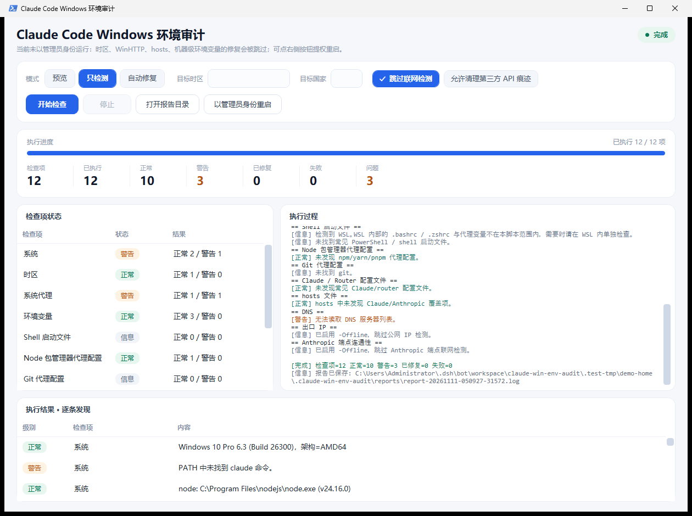

# Claude Win Env Audit（Windows 版本）

Windows 版 Claude Code 环境检测与修复工具，用于排查常见的代理、时区、DNS、hosts、包管理器代理、Claude / Claude Code Router 配置残留等问题，并给出中文建议。命令行脚本与 WPF 图形界面共用同一套检测逻辑。

本目录是 [claude-mac-env-audit](../README.md) 的 Windows 对应实现，沿用相同的结构与安全模型：单文件检测脚本 + 隔离测试 + CI，按「检测 → 分级 → 备份 → 确认 → 修复 → 报告」的顺序工作，只把 macOS 的系统接口换成 Windows 对应实现。

脚本默认会自动修复可安全处理的本地配置项。涉及第三方 API 痕迹时会先询问确认，避免误删你仍在使用的自定义服务配置。

涉及系统级设置的项目需要管理员权限（例如修改系统时区、WinHTTP 代理、hosts、机器级环境变量）。未提权时脚本只提示并跳过，可以加 `-Elevate` 让脚本自动以管理员身份重启。只检测或预览模式不会申请任何权限。

## 功能

- 检测 Windows 版本、Build、架构、`claude` 和 `node` 环境。
- 检查系统时区（Windows 时区 ID 和 node Intl 名称）；默认只有明确传入目标时区时才自动修改，`-Aggressive` 可为中国大陆时区选择迁移目标；不会把新加坡、东京等境外时区单独判为风险。
- 检查 WinINET 系统代理（`ProxyEnable` / PAC）与 WinHTTP 代理，并可关闭；同时提示是否存在 TUN/VPN 虚拟网卡。
- 检查当前进程、用户级、机器级环境变量中的代理和基础 URL。
- 检查 PowerShell 启动文件、cmd.exe AutoRun 中的代理和基础 URL 配置。
- 清理 npm/yarn/pnpm/git 中的代理残留。
- 检查 Claude / Claude Code Router 配置中的代理、自定义端点、第三方 API 痕迹。
- 检查 `C:\Windows\System32\drivers\etc\hosts` 中的 Claude/Anthropic 覆盖项。
- 检查 DNS 服务器、当前出口 IP、IPv4/IPv6 出口国家、`api.anthropic.com` 连通性；默认接受中国大陆以外的国家，也可指定目标国家。
- 每次运行会生成报告；修改文件前会生成备份。

出口国家检测是一次运行时快照，只能说明当前请求的出口位置，不能单凭一次结果证明线路长期固定。需要固定国家时，请使用 `-TargetCountry` 并在不同时间重复运行。

## 目录结构

```text
windows/
├─ 启动审计界面.vbs              双击启动图形界面（无控制台窗口）
├─ 启动审计界面.cmd              同上（命令行方式）
├─ claude_win_env_audit.ps1      检测与修复主脚本（CLI）
├─ app/ClaudeWinEnvAudit.Gui.ps1 图形界面（WPF）
├─ tests/test_cli.ps1            命令行隔离测试
├─ tests/test_gui.ps1            界面与事件流测试
├─ docs/screenshot.png           界面截图
└─ README.md
```

## 图形界面

双击 `启动审计界面.vbs`（无控制台窗口）或 `启动审计界面.cmd`，或在 `windows/` 目录下运行：

```powershell
powershell -STA -ExecutionPolicy Bypass -File app\ClaudeWinEnvAudit.Gui.ps1
```



界面里能看到：

- 检查项总数和已执行数量（进度条），共 12 个检查项。
- 每个检查项的实时状态（等待 / 运行中 / 正常 / 警告 / 已修复 / 失败）和小节统计。
- 执行结果：逐条发现列表（级别、检查项、内容，最多 800 条）。
- 执行过程：与命令行一致的实时日志。
- 汇总计数：正常、警告、已修复、失败、问题数。

可选项：模式（预览 / 只检测 / 自动修复）、目标时区、目标国家、跳过联网检测，以及「允许清理第三方 API 痕迹」（等价 `-Force`，默认关闭）。未以管理员身份运行时界面会提示，可点「以管理员身份重启」；系统级修复在未提权时会被跳过而不是半途修改。

图形界面通过主脚本的 `-EventLog` 事件流（JSON Lines）获取进度和结果，不改动命令行的任何行为；自动化脚本也可以直接消费这个事件流。

## 使用

以下命令在 `windows/` 目录下执行。预览将要执行的修复，不修改系统或用户配置：

```powershell
.\claude_win_env_audit.ps1 -DryRun
```

`-DryRun` 仍会在 `%USERPROFILE%\.claude-win-env-audit\` 生成权限受限的本地报告。

只检测，不显示拟执行的修复动作：

```powershell
.\claude_win_env_audit.ps1 -CheckOnly
```

执行检测并自动修复可安全处理的项目：

```powershell
.\claude_win_env_audit.ps1
```

需要修改系统级配置时，请以管理员身份打开 PowerShell 再运行；或者：

```powershell
.\claude_win_env_audit.ps1 -Elevate
```

中国大陆时区未指定目标时，使用 `Taiwan Standard Time` 作为迁移目标：

```powershell
.\claude_win_env_audit.ps1 -Aggressive
```

明确指定要检查并修复到的目标时区，支持 Windows 时区 ID 或常用 IANA 名称：

```powershell
.\claude_win_env_audit.ps1 -TargetTz Asia/Tokyo
.\claude_win_env_audit.ps1 -TargetTz Asia/Singapore
.\claude_win_env_audit.ps1 -TargetTz "Tokyo Standard Time"
```

指定期望的出口国家，例如日本、新加坡、美国：

```powershell
.\claude_win_env_audit.ps1 -TargetCountry JP
.\claude_win_env_audit.ps1 -TargetCountry SG
.\claude_win_env_audit.ps1 -TargetCountry US
```

只运行部分小节：

```powershell
.\claude_win_env_audit.ps1 -DryRun -Only timezone,system-proxy,claude-configs
```

不向公网 IP 查询服务和 Anthropic 端点发起请求：

```powershell
.\claude_win_env_audit.ps1 -DryRun -Offline
```

如果系统提示禁止运行脚本：

```powershell
powershell -ExecutionPolicy Bypass -File .\claude_win_env_audit.ps1 -DryRun
```

## 参数

| 参数 | 说明 |
| --- | --- |
| `-DryRun` | 显示拟执行的修复，不修改系统或用户配置；仍会生成本地报告。 |
| `-CheckOnly` / `-NoFix` | 只检测，不显示拟执行的修复动作。 |
| `-Aggressive` | 中国大陆时区未指定目标时，使用 `Taiwan Standard Time` 作为迁移目标；不会修改其他境外时区。 |
| `-TargetTz TZ` | 明确指定要检查并修复到的目标时区，例如 `Asia/Tokyo` 或 `Tokyo Standard Time`。 |
| `-TargetCountry CC` | 检查当前出口是否匹配两位国家代码，例如 `US`、`JP`、`SG`。不指定时默认接受中国大陆以外的国家。 |
| `-Only 小节` | 只执行指定小节，逗号分隔。可选：`os` `timezone` `system-proxy` `env` `shell-startup` `package-managers` `git` `claude-configs` `hosts` `dns` `exit-ip` `anthropic`。 |
| `-Offline` | 跳过公网 IP 和 Anthropic 端点联网检测。 |
| `-Force` | 自动确认第三方 API 痕迹清理，不再逐个询问。 |
| `-NonInteractive` | 没有可交互终端时使用；会跳过所有需要人工确认的清理。 |
| `-Elevate` | 需要管理员权限时自动以管理员身份重启本脚本。 |
| `-AuditHome 路径` | 指定用户主目录（用于测试或审计其他用户配置），默认 `$env:USERPROFILE`。 |
| `-EventLog 路径` | 把结构化事件按 JSON Lines 写入指定文件（图形界面用它读取进度；也可用于自动化）。 |
| `-Version` | 显示版本号。 |
| `-Help` | 显示帮助。 |

## 安全策略

- 修改用户文件或 hosts 前会先备份；备份失败时取消对应修改，不会继续写原文件。
- 修改注册表前用 `reg export` 备份对应键。
- 修改系统设置或 hosts 时要求管理员权限；权限不足只提示并跳过，不会静默半途修改。
- 不会删除账号、应用、凭据、支付数据或浏览器配置。
- 清理第三方 API 痕迹前会询问确认，输入 `y` 才会执行；`-Force` 才跳过询问。
- PowerShell 启动文件、cmd.exe AutoRun、Claude/Router JSON 配置中的第三方 API 修改都受确认门保护。
- JSON 清理只删除明确匹配的代理/基础 URL 字段，不删除通用 `endpoint` 字段；确认前会显示字段路径但隐藏字段值。
- 没有可交互终端时，会跳过第三方 API 痕迹清理。
- 日志隐藏代理 URL、第三方基础 URL 等配置值；报告和备份权限会收紧为仅当前用户可读。
- `NO_PROXY`/`no_proxy` 不定义代理入口，脚本不会自动删除。
- 脚本无法移除父级 shell 中已经存在的环境变量；修复后建议打开新的终端窗口重新检查。

报告和备份默认写入：

```text
%USERPROFILE%\.claude-win-env-audit\reports\
%USERPROFILE%\.claude-win-env-audit\backups\
```

JSON 清理使用 PowerShell 自带的 `ConvertFrom-Json` / `ConvertTo-Json`，不需要额外安装 Python。清理前会先确认最终结果仍然是合法 JSON。

未使用 `-Offline` 时，出口检测会依次尝试 `ipinfo.io`、`ifconfig.co`、`ipapi.co`，并请求 `api.anthropic.com` 验证连通性；IPv4/IPv6 出口国家通过 `curl.exe`（Windows 10 1803 起自带）探测。

## 需要管理员权限的项目

| 项目 | 原因 |
| --- | --- |
| 修改系统时区 | `Set-TimeZone` 需要管理员权限。 |
| 重置 WinHTTP 代理 | `netsh winhttp reset proxy` 需要管理员权限。 |
| 清理 hosts | `C:\Windows\System32\drivers\etc\hosts` 受系统保护。 |
| 删除机器级环境变量 | 对应 `HKLM` 下的环境变量键。 |

用户级环境变量（`HKCU`）、用户目录下的配置文件、npm/yarn/pnpm/git 配置不需要管理员权限。

## 与 macOS 版的对应关系

| macOS 版 | Windows 版 |
| --- | --- |
| `sw_vers` / `uname -m` | `Get-CimInstance Win32_OperatingSystem` / `$env:PROCESSOR_ARCHITECTURE` |
| `systemsetup -settimezone` + `Asia/Tokyo` 等 IANA 名称 | `Set-TimeZone` + Windows 时区 ID，常用 IANA 名称自动映射 |
| `scutil --proxy` / `networksetup` | WinINET 注册表（`ProxyEnable`/`AutoConfigURL`）+ WinHTTP（`netsh winhttp`） |
| `utun` 接口检测 | `Get-NetAdapter` 检测 TUN/VPN 虚拟网卡 |
| `launchctl getenv/setenv` | 用户级 / 机器级环境变量（`HKCU`/`HKLM`）+ 进程环境变量 |
| `.zshenv` `.zshrc` `.bashrc` 等 | PowerShell 启动文件、cmd.exe AutoRun |
| `/etc/hosts` | `C:\Windows\System32\drivers\etc\hosts` |
| `scutil --dns` | `Get-DnsClientServerAddress` |
| `curl -4/-6 ifconfig.co` | 同左，走 `curl.exe` |
| `sudo` 按需授权 | 管理员权限检测 + `-Elevate` 重新启动 |

Windows 特有、mac 版没有的检查：WinHTTP 代理、cmd.exe AutoRun、机器级（`HKLM`）环境变量、系统时区自动同步服务提示。

## 开发与测试

在仓库根目录运行隔离测试：

```powershell
pwsh -NoProfile -File windows/tests/test_cli.ps1
pwsh -NoProfile -File windows/tests/test_gui.ps1
```

只装了系统自带 Windows PowerShell 5.1 时：

```powershell
powershell -NoProfile -ExecutionPolicy Bypass -File windows\tests\test_cli.ps1
powershell -NoProfile -ExecutionPolicy Bypass -File windows\tests\test_gui.ps1
```

`test_cli.ps1` 覆盖命令行行为、dry-run/check-only 差异、第三方 API 清理、备份与报告、参数校验；`test_gui.ps1` 覆盖 XAML 与控件完整性，以及图形界面依赖的事件流结构（`meta` / `section-start` / `finding` / `section-end` / `done`）。

测试全部在临时目录内进行，不改动真实用户配置、注册表和 hosts；GitHub Actions 会在每次推送和 Pull Request 时运行同一组测试（`windows-latest`）。

脚本兼容 Windows PowerShell 5.1 与 PowerShell 7。修改 `.ps1` 文件后请保持 UTF-8 BOM 编码，否则 Windows PowerShell 5.1 会把中文按 ANSI 解析。图形界面需要 WPF（Windows 自带），并且要在 STA 线程上运行；`启动审计界面.cmd` 与 `.vbs` 已处理。

## 适用范围

此脚本只面向 Windows。它用于本机环境排查和配置卫生检查，不保证解决任何平台账号、风控或服务可用性问题。请遵守你所在地区的法律法规和相关服务条款。

## 许可证

MIT，与仓库根目录的 [LICENSE](../LICENSE) 一致。
